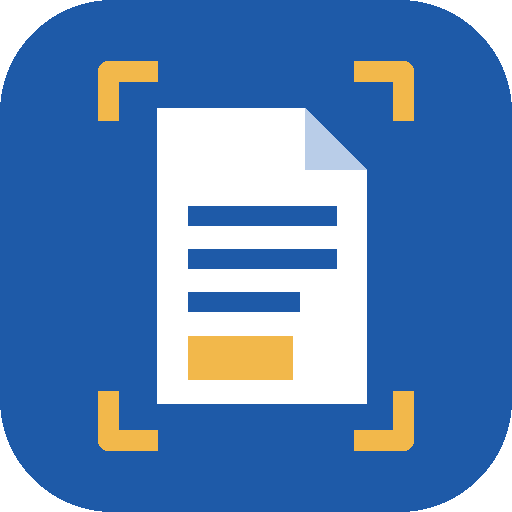

<p align="center"></p>

# 掃描成PDF Scan to PDF

把拍下的文件、相片和現有的 PDF 合成一個 PDF。完全離線、不需要任何權限。
Turn photographed documents, pictures and existing PDFs into one PDF. Fully offline, no permissions.

---

## 中文說明

### 功能
- **拍照**：開啟手機的相機 App 拍文件，拍完直接進入裁切畫面。
- **相簿**：一次選多張相片（Android 13 以上使用系統相片挑選器）。
- **匯入檔案**：選擇圖片或 PDF 檔，PDF 的每一頁都會變成一頁。
- 也可以在其他 App 按「分享」，把圖片或 PDF 傳進來。
- **裁切**：拖動 4 個藍點到文件四個角，自動拉正（透視校正）；拖動時有放大鏡（Android 9 以上）。
- **濾鏡**：原圖／灰階／黑白（自適應門檻，可去除紙張上的陰影）。
- 每一頁可 **旋轉、上移、下移、刪除**。
- **儲存 PDF**：用系統「另存新檔」畫面存到手機、雲端硬碟等位置。
- **分享 PDF**：直接傳到 LINE、Email 等任何 App。
- PDF 為 A4，每頁依圖片方向自動直式／橫式，約 240 dpi、JPEG 壓縮。
- 頁面會自動保存，App 被關掉也不會遺失。
- 大按鈕、大字體，操作簡單。

### 權限
**不需要任何權限**（沒有網路、沒有相機、沒有儲存空間權限）：
拍照交給系統相機 App，選檔與存檔都使用系統內建的選擇器。

### 注意事項
- 不會自動偵測文件邊緣，請手動拖動四個角。
- 有密碼保護的 PDF 無法匯入。
- 匯入的 PDF 會轉成圖片，文字無法再選取或搜尋（沒有 OCR）。

---

## English

### Features
- **Take photo** with the phone's camera app; the crop screen opens right after.
- **Photos**: pick several pictures at once (system Photo Picker on Android 13+).
- **Files**: import images or PDFs – every PDF page becomes a page.
- Share images/PDFs into the app from other apps.
- **Crop** by dragging 4 corners with perspective correction and a magnifier (Android 9+).
- **Filters**: original / grayscale / black & white (adaptive threshold, removes shadows).
- **Rotate, move up/down, delete** each page.
- **Save PDF** anywhere through the system "Save as" screen, or **Share PDF** to any app.
- A4 pages, portrait or landscape per page, ~240 dpi JPEG.
- Pages are kept on disk, so nothing is lost if Android closes the app.
- Big buttons and large text.

### Permissions
**None** – no Internet, no Camera, no storage permission. Photos are taken by the system camera
app; files are opened and saved through the system pickers.

### Limitations
- No automatic edge detection – drag the corners yourself.
- Password-protected PDFs can't be imported.
- Imported PDFs are rasterised; no OCR, so text isn't selectable.

---

## Build

Requirements: JDK 17+, Android SDK 36.

```sh
./gradlew assembleRelease   # unsigned unless a keystore.properties is provided
./gradlew testReleaseUnitTest
```

Pure Kotlin + Android platform APIs only. No AndroidX, no Google Play Services, no trackers.

## License

[MIT](LICENSE) © 2026 Luke Chen
